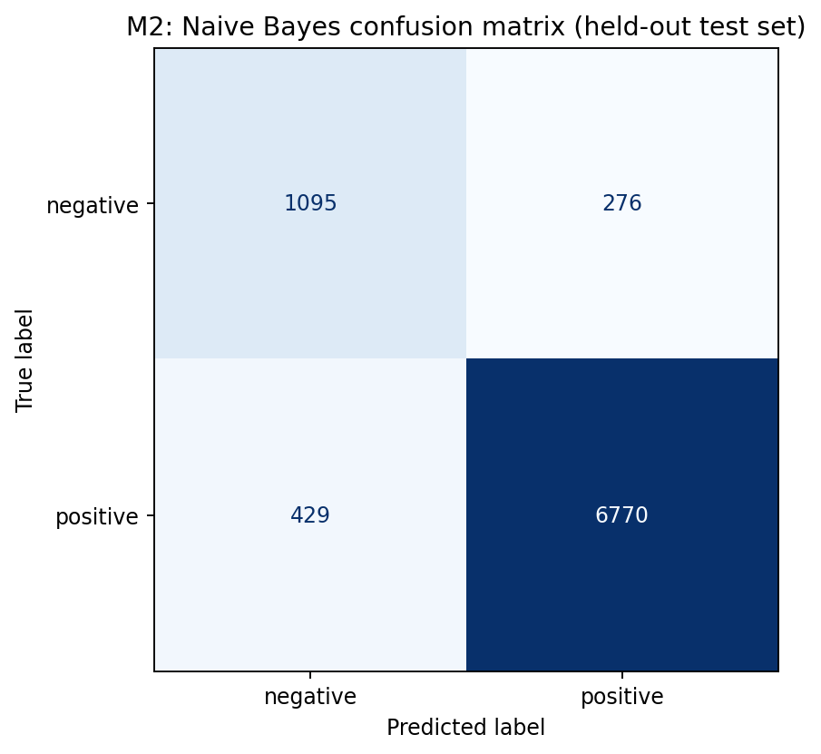

# Milestone 2: Feature Engineering & Baseline Results

**CSE 3521: Survey of AI I · Autumn 2026 · Group Gamma**  
**The Ohio State University · Data seed: 44 · Submission: November 18, 2026**  
**GitHub repository:** https://github.com/PowerSixxx/cse3521-sentiment

> **Report status:** Completed findings are populated from the team's M2 notes. Bracketed `[TO ADD]` fields require verification or insertion before PDF submission. Target length: **3–5 pages** after figures are inserted.

## 1. Feature Engineering Report

### Dataset and preprocessing

We use a 50,000-review sample of Amazon Fine Food Reviews, selected with random seed 44. Reviews rated **1–2 stars** are labeled negative, and reviews rated **4–5 stars** are labeled positive; 3-star reviews are excluded. After filtering and deduplication, **42,848 binary-labeled reviews** remain. We use a stratified **80/20 train/test split** (seed 44), yielding **34,278 training** and **8,570 test** reviews. The same held-out test set is used for the baseline comparison.

| Representation | Method | Vocabulary / dimension | Purpose |
|---|---|---|---|
| Bag of Words (BoW) | Unigram and bigram counts | Up to **50,000 terms**; actual fitted size: **[TO ADD]** | Interpretable counts for Multinomial Naive Bayes |
| TF-IDF | **[TO ADD: exact n-gram range, preprocessing, weighting settings]** | **[TO ADD: fitted vocabulary size]** | Weight informative words relative to common terms |

### Most informative BoW features

The team's Naive Bayes results identify the following terms as informative for each sentiment class. The ranking criterion or coefficient/log-probability scoring method should be documented in the final report.

| Rank | Positive sentiment | Negative sentiment |
|---:|---|---|
| 1 | very fresh | false advertising |
| 2 | can beat | what disappointment |
| 3 | also great | never purchase |
| 4 | best ve | zero stars |
| 5 | best coffee | threw away |
| 6 | not overpowering | cannot return |
| 7 | flavorful and | and unpleasant |
| 8 | snack or | huge disappointment |
| 9 | yum yum | two stars |
| 10 | great too | emerald forest |

**Interpretation:** Some informative terms are clearly sentiment-bearing (for example, “false advertising” and “yum yum”), while others suggest tokenization artifacts or dataset-specific associations (for example, “best ve” and “can beat”). The latter motivate closer examination of contraction handling.

### Most informative TF-IDF features

**[TO ADD: Explain how informative terms were ranked for TF-IDF. Insert top-10 positive and top-10 negative terms, or explicitly state if the same model weights were used.]**

| Rank | Positive TF-IDF term | Negative TF-IDF term |
|---:|---|---|
| 1–10 | **[TO ADD: 10 ranked terms]** | **[TO ADD: 10 ranked terms]** |

**Figure 1. Feature-space visualization.**  
``

**[TO ADD: Insert one completed feature visualization (e.g., top-term frequencies or PCA scatter) and 1–2 sentences explaining what it shows. Baowen's progress log reports that two feature figures have been prepared.]**

## 2. Baseline Results

The classical baseline is **Multinomial Naive Bayes** trained on BoW unigrams and bigrams. Its smoothing parameter was selected by cross-validation (**best α = 0.5**; cross-validation macro-F1 = **0.8580**). The majority-class baseline always predicts **positive** sentiment, the dominant class.

| Model | Accuracy | Macro precision | Macro recall | Macro F1 | Negative recall | Negative F1 |
|---|---:|---:|---:|---:|---:|---:|
| Majority class | 0.8400 | 0.4200 | 0.5000 | 0.4565 | 0.0000 | 0.0000 |
| Multinomial NB (BoW) | **0.9177** | **0.8397** | **0.8695** | **0.8535** | **0.7987** | **0.7565** |

**Figure 2. Naive Bayes confusion matrix (held-out test set).**

{width=65%}

**[TO ADD: Ensure the referenced image exists in the `figures/` directory; optionally summarize TP, TN, FP, and FN from the figure.]**

**Interpretation:** Naive Bayes reaches **91.77% test accuracy**, compared with **84.00%** for the majority-class baseline, an improvement of **7.77 percentage points**. The majority baseline fails to identify any negative reviews (negative recall and F1 both zero). Naive Bayes identifies **79.87%** of negative reviews (negative F1 = **0.7565**), demonstrating meaningful learning beyond class frequency alone. Its remaining errors, especially on negative reviews, motivate further model and feature improvements.

## 3. Error Analysis

The team examined **ten reviews** misclassified by Multinomial Naive Bayes. A recurring difficulty was **mixed sentiment**: a review might praise a product's taste but criticize its packaging, causing positive words to dominate even when the overall label is negative. Another issue is **negation**. Phrases such as “not very good” contain individually positive words but express negative sentiment. The current tokenization can also lose contractions: for example, “can't beat” may be represented as “can beat.”

**Table 3. Misclassified review examples — insert 5–10 actual observations.**

| Example | True label | Predicted label | Short excerpt / review ID | Likely failure pattern |
|---:|---|---|---|---|
| 1 | [TO ADD] | [TO ADD] | [TO ADD] | [TO ADD] |
| 2 | [TO ADD] | [TO ADD] | [TO ADD] | [TO ADD] |
| 3 | [TO ADD] | [TO ADD] | [TO ADD] | [TO ADD] |
| 4 | [TO ADD] | [TO ADD] | [TO ADD] | [TO ADD] |
| 5 | [TO ADD] | [TO ADD] | [TO ADD] | [TO ADD] |
| 6–10 (optional) | [TO ADD] | [TO ADD] | [TO ADD] | [TO ADD] |

**Proposed improvements:** For M3, test a tokenizer that preserves contractions and negation. Compare TF-IDF-based Logistic Regression against Naive Bayes, and investigate whether weighting and hyperparameter tuning improve negative-class recall and macro-F1. These are proposed changes, **not yet measured improvements**.

## 4. Updated Timeline

| Dates | Milestone | Responsibilities |
|---|---|---|
| Nov 11–18 | **M2** (extended to Wed Nov 18) | **Henry:** cleaning, deduplication, split, majority baseline, Naive Bayes on BoW. **Baowen:** seed-44 sample, Streamlit skeleton, TF-IDF and feature figures. **Tarun:** error analysis and M2 report. **Andrew:** review revised timeline. |
| Nov 19–22 | **M3** (Sun Nov 22) | **Henry:** TF-IDF Logistic Regression and comparison. **Andrew:** FFNN training and loss curves. **Baowen:** second app model and Streamlit Cloud deployment. **Tarun:** README reproducibility steps. **Andrew + Tarun:** comparison table and M3 report. |
| Nov 23–29 | **M4** (Sun Nov 29) | **Baowen:** final deployment. **Tarun:** final report. **Andrew:** slides. **All:** contribution paragraphs and proofreading. |
| Nov 30–Dec 2 | **Live demo** | **All:** rehearse 8-minute demo and Q&A. |

**Scope changes and rationale:** TF-IDF moved from Tarun to Baowen because Baowen finished the app skeleton early and could complete the second feature representation. The FFNN moved from M2 to M3 because TF-IDF features were only ready on Nov 17; DistilBERT remains a stretch goal. Negation-aware tokenization was added to M3 after error analysis identified contraction-handling issues.

## 5. Individual Progress Log

**Baowen Liu — App Engineer.** Since M1, Baowen generated the shared seed-44 sample and built the Streamlit app skeleton (`app.py`), which loads the saved Naive Bayes model and predicts sentiment from pasted text. Baowen also built the TF-IDF representation in `notebooks/feature_engineering.ipynb`, including its vocabulary size, top-10 terms for each class, and two feature figures. Next: add a second model to the app and deploy it to Streamlit Community Cloud.

**Henry Benner — ML Engineer (classical).** Since M1, Henry built `notebooks/classical_models.ipynb` covering data cleaning, deduplication, the stratified 80/20 split, the majority-class baseline, and cross-validated Multinomial Naive Bayes on BoW (α = 0.5). Naive Bayes achieved **91.8%** test accuracy versus **84.0%** for the majority baseline. Next: train and tune Logistic Regression on TF-IDF and compare results.

**Tarun Shivakumar — Data Engineer and Analyst / Writer.** Since M1, Tarun prepared and uploaded the final M1 charter PDF. For M2, Tarun is writing the error analysis and assembling the report. Next: document reproducibility steps in the README for M3.

**Andrew Kobasko — Project Lead and ML Engineer (deep).** Since M1, Andrew coordinated the M2 plan and reviewed the revised timeline. Next: build and train the feedforward neural network on TF-IDF features and plot training and validation loss curves for M3.

---

**Submission checklist:** [ ] Add actual BoW and TF-IDF fitted dimensions  · [ ] Add TF-IDF top-10 terms  · [ ] Insert feature figure  · [ ] Include confusion-matrix image  · [ ] Add 5–10 actual misclassified review examples  · [ ] Check PDF is 3–5 pages  · [ ] Verify GitHub link and push updated repository.
