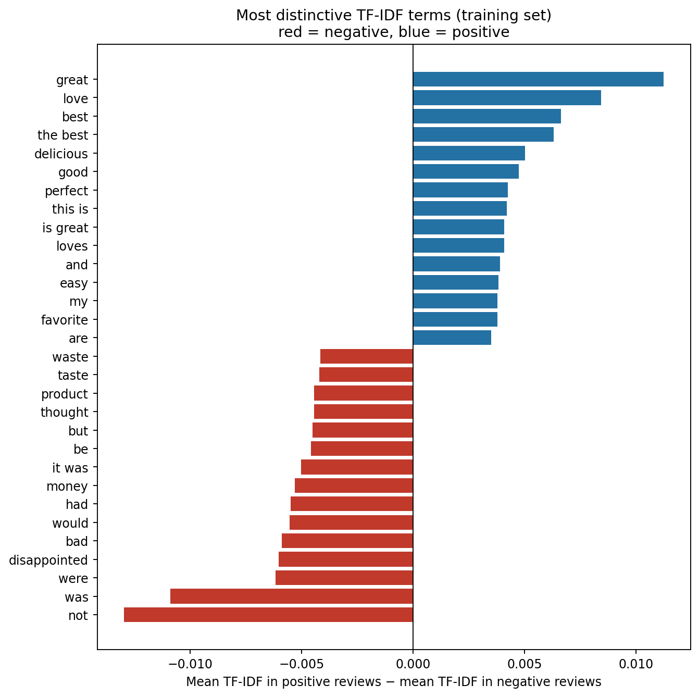

# Milestone 2: Feature Engineering & Baseline Results

**CSE 3521: Survey of AI · Autumn 2026 · Group Gamma**  
**The Ohio State University · Data seed: 44 · Submission: November 18, 2026**  
**GitHub repository:** https://github.com/PowerSixxx/cse3521-sentiment

## 1. Feature Engineering Report

### Dataset and preprocessing

We use a 50,000-review sample of Amazon Fine Food Reviews, selected with random seed 44. Reviews rated **1–2 stars** are labeled negative, and reviews rated **4–5 stars** are labeled positive; 3-star reviews are excluded. After filtering and deduplication, **42,848 binary-labeled reviews** remain. We use a stratified **80/20 train/test split** (seed 44), yielding **34,278 training** and **8,570 test** reviews. The same held-out test set is used for the baseline comparison.

| Representation | Method | Vocabulary / dimension | Purpose |
|---|---|---|---|
| Bag of Words (BoW) | Unigram and bigram counts | Up to **50,000 terms**; actual fitted size: 50000 | Interpretable counts for Multinomial Naive Bayes |
| TF-IDF | N-gram range (1, 2), minimum doc frequency is 2, max features: 50000 | Trained on 42848 reviews, training matrix density: 0.1934%, tested on 8570 reviews. | Weight informative words relative to common terms |

### Most informative BoW features

The team's Naive Bayes results identify the following terms as informative for each sentiment class. The ranking criterion or coefficient/log-probability scoring method should be documented in the final report.

| Rank | Positive sentiment | Negative sentiment |
|---:|---|---|
| 1 | very fresh | false advertising |
| 2 | can beat | what disappointment |
| 3 | also great | never purchase |
| 4 | best ve | zero stars |
| 5 | best coffee | threw away |
| 6 | not overpowering | cannot return |
| 7 | flavorful and | and unpleasant |
| 8 | snack or | huge disappointment |
| 9 | yum yum | two stars |
| 10 | great too | emerald forest |

**Interpretation:** Some informative terms are clearly sentiment-bearing (for example, “false advertising” and “yum yum”), some of the other sentiment tokens are clearly artifacts, either poor tokenization due to underlying dataset inconsistency (for example, “best ve” and “can beat”). The results suggest that the reviews need to be standardized for language, as some words contain white spaces where they should not be.

### Most informative TF-IDF features

Below represents the TF-IDF most distinctive terms based on our training dataset. The rank order is from 1 through 10, where 1 represents the most distinctive for positive TF-IDF terms, and 1 represents the most distinctive term for negative TF-IDF terms. Individual words are not always included, for example, one of the results for the most distinct negative TF-IDF term is 'it was', this is a combined term as 'it' on its own does not provide much semantic meaning. Where more meaning is explained when combined the following word together. Combining these terms also reduces the frequency as function words occur commonly in sentence construction.

| Rank | Positive TF-IDF term | Negative TF-IDF term |
|---:|---|---|
| 1 | great | not |
| 2 | love | was |
| 3 | best | were |
| 4 | the best | disappointed |
| 5 | delicious | bad |
| 6 | good | would |
| 7 | perfect | had |
| 8 | this is | money |
| 9 | is great | it was |
| 10 | loves | be |

Looking at the results, regardless, there contains a large number of function words, or stop words. Which semantically do not guarantee correlation with positive or negative sentiment. This is a result due to high occurrences. A possible improvement would include to only conduct TF-IDF on nouns, adjectives, and verbs.

**Figure 1. Feature-space visualization.**  

## 2. Baseline Results

The classical baseline is **Multinomial Naive Bayes** trained on BoW unigrams and bigrams. Its smoothing parameter was selected by cross-validation (**best α = 0.5**; cross-validation macro-F1 = **0.8580**). The majority-class baseline always predicts **positive** sentiment, the dominant class.

| Model | Accuracy | Macro precision | Macro recall | Macro F1 | Negative recall | Negative F1 |
|---|---:|---:|---:|---:|---:|---:|
| Majority class | 0.8400 | 0.4200 | 0.5000 | 0.4565 | 0.0000 | 0.0000 |
| Multinomial NB (BoW) | **0.9177** | **0.8397** | **0.8695** | **0.8535** | **0.7987** | **0.7565** |

**Figure 2. Naive Bayes confusion matrix (held-out test set).**

{width=65%}

**Interpretation:** Our Multinomial Naive Bayes model had an accuracy of 91.77% compared with 84.00% for the majority-class baseline. This shows that our Naive Bayes model performed better overall, improving accuracy by 7.77 percentage points.

The majority-class baseline always predicts positive sentiment, so it fails to identify negative reviews. Its negative-class recall and F1-score are both zero.

Naive Bayes achieved a negative-class recall of 79.87% and a negative-class F1-score of 0.7565. This indicates that the model can identify a majority of negative reviews rather than always predicting the positive class.

These results show that Naive Bayes can learn relationships between word frequencies and sentiment. However, the model still makes mistakes when identifying negative reviews, meaning there is room for improvement.

## 3. Error Analysis

We examined five reviews misclassified by Multinomial Naive Bayes. A recurring difficulty was mixed sentiment: a review might praise a product's taste but criticize its packaging, causing positive words to dominate even when the overall label is negative. Another issue is **negation**. Phrases such as “not very good” contain individually positive words but express negative sentiment. The current tokenization can also lose contractions: for example, “can't beat” may be represented as “can beat.” Lots of the reviews contain primarily adjectives or nouns that are incorrectly spelled, this would not be corrected by the classical models. Lastly, many of the models include stop and function words which do not add much semantic meaning to the review sentiment. This skews the results, a suggested improvement is to only conduct classical methods on nouns, verbs, and adjectives.

**Table 3. Misclassified review examples**

| Example | True label | Predicted label | Short excerpt / review ID | Likely failure pattern |
|---:|---|---|---|---|
| 1 | Positive | Negative | After trying other methods without success, I bought these traps based on Amazon's customer reviews and the price... | Lacked distinct positive words in text, 'without' possible skewed result to negative |
| 2 | Negative | Positive | Tortilla Land can no longer claim their tortillas are healthy. Tortilla Land have integrity and get rid of the sugar... | Classical model does not understand keywords in context, words such as health and integrity seem as positive without context |
| 3 | Negative | Positive | That isn't what chocolate chip cookies should be about. The oatmeal version of these cookies is much better... | Classical model does not understand word context, phrases such as 'much better' would be indicated as positive in the model but in-fact in context is negative |
| 4 | Negative | Positive | I love the regular of this type of oatmeal and made the mistake of ordering such a big quantity of this assuming the family and I found like it. We dont... | Classical model does not understand words in context, in this case the phrase 'I found like it' would weigh more positive; however, it is negative in context.|
| 5 | Positive | Negative | They came in a timely manner and nothing was wrong with them. They tasted just like they should and weren't squished.... | Classical model does not understand words in context, words such as 'wrong' and 'weren't' lean on negative but in context is actually positive |

## 4. Updated Timeline

| Dates | Milestone | Responsibilities |
|---|---|---|
| Nov 11–18 | **M2** (extended to Wed Nov 18) | **Henry:** Full implementation of all classical models and providing training model. **Baowen:** seed-44 sample, Streamlit skeleton, running statistics on classical models (feature engineering). **Tarun:** Error analysis, validate data cleaning methods for accuracy. **Andrew:** Review revised timeline, prepare compressive data cleaning for FFNN, write up M2 checkpoint document |
| Nov 19–22 | **M3** (Sun Nov 22) | **Henry:** TF-IDF Logistic Regression and comparison. **Andrew:** FFNN training and loss curves. **Baowen:** second app model and Streamlit Cloud deployment. **Tarun:** README reproducibility steps. **Andrew + Tarun:** comparison table and M3 report.|
| Nov 23–29 | **M4** (Sun Nov 29) | **Baowen:** final deployment. **Tarun:** final report. **Andrew:** slides. **All:** contribution paragraphs and proofreading. |
| Nov 30–Dec 2 | **Live demo** | **All:** rehearse 8-minute demo and Q&A. |

**Scope changes and rationale:**  The FFNN moved from M2 to M3 because TF-IDF features were only ready on Nov 17; DistilBERT remains a stretch goal. Negation-aware tokenization was added to M3 after error analysis identified contraction-handling issues. The new data cleaning approach will be implemented for upcoming models. Current results are based on initial data cleaning methods.

## 5. Individual Progress Log

**Baowen Liu — App Engineer.** Since M1, I generated the shared seed-44 sample and built the Streamlit app skeleton (app.py), which loads our saved Naive Bayes model and predicts the sentiment of a pasted review. I also built the TF-IDF representation in notebooks/feature_engineering.ipynb, with its vocabulary size, top-10 terms for each class, and two feature figures. Next, I will add the second model to the app and deploy it to Streamlit Community Cloud.

**Henry Benner — ML Engineer (classical).** Since Milestone 1, I built notebooks/classical_models.ipynb. This includes data cleaning and deduplication, a stratified 80/20 train/test split, a majority-class baseline, and a Multinomial Naive Bayes model that uses Bag of Words. I trained the Naive Bayes model using cross-validation and found that the best alpha ended up being 0.5. My Naive Bayes model achieved 91.8% test accuracy compared to 84% for the majority-class baseline. On top of this, I worked on implementing Logistic Regression using TF-IDF features and saving the trained model so it can be used later in our Streamlit application. Following this, I will finalize the Logistic Regression results and compare its performance against Naive Bayes.

**Tarun Shivakumar — Data Engineer and Analyst / Writer.** Since M1, Tarun prepared and uploaded the final M1 charter PDF. For M2 he worked with Andrew to do error analysis and assist in the new iteration data cleaning. 

**Andrew Kobasko — Project Lead and ML Engineer (deep).** Compiled final M2 report draft, ensured that all components of the M2 checkpoint are met and complete. Designed new iteration data cleaning script to prepare data frame for FFNN, conducted deep error analysis and checking edge cases for model inaccuracies. 

