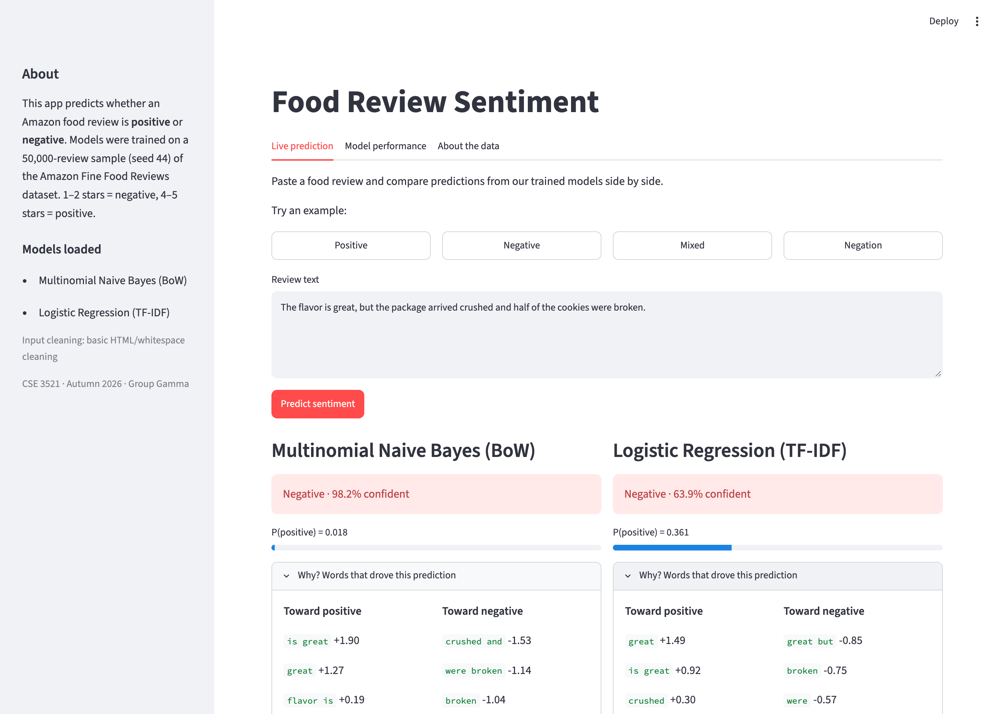

# Milestone 3: Refined Solution & App Prototype

**CSE 3521: Survey of AI · Autumn 2026 · Group Gamma**  
**The Ohio State University · Data seed: 44 · Submission: November 22, 2026**  
**GitHub repository:** https://github.com/PowerSixxx/cse3521-sentiment  
**Streamlit deployment:** [Insert URL or indicate local prototype]

## 1. Model Comparison

### Dataset and experimental setup

We use a seed-44 sample of 50,000 Amazon Fine Food Reviews. Reviews rated **1–2 stars** are labeled negative, and reviews rated **4–5 stars** are labeled positive; 3-star reviews are excluded.

[Describe the finalized preprocessing changes since M2, including contraction handling, spelling correction, and deduplication, as applicable. Report the final dataset size, training/validation/test sizes, and confirm that all models are evaluated on the same held-out test set.]

### Unified model comparison

**Table 1. Model performance on the held-out test set**

| Model | Accuracy | Macro precision | Macro recall | Macro F1 | Training time (s) |
|---|---:|---:|---:|---:|---:|
| Majority class | — | — | — | — | — |
| Multinomial NB (BoW) | — | — | — | — | — |
| Logistic Regression (TF-IDF) | — | — | — | — | — |
| Feedforward Neural Network (FFNN) | — | — | — | — | — |

[Include one row per additional trained model. Bold the best results. Specify the hardware and whether training times include feature extraction or hyperparameter tuning. Use consistent macro-averaged metrics across models.]

### Best-performing model

**Interpretation:** [Identify the best-performing model using macro F1 as the primary comparison metric, or justify another metric. Quantify its improvement over the classical and majority-class baselines. Explain the differences using course concepts such as model capacity, nonlinear decision boundaries, feature representation, and sequence information where applicable. Discuss any trade-off between predictive performance and training time.]

## 2. Deep / Modern Model Analysis

### Model architecture

Our planned deep model is a **Feedforward Neural Network (FFNN)** for binary sentiment classification.

[Confirm the implemented architecture and explain why it was selected. Describe the input representation, hidden layers, activation functions, output layer, and regularization. If another modern model was used, replace the FFNN description accordingly.]

| Component | Configuration |
|---|---|
| Input representation and dimension | [Insert] |
| Hidden layers and units | [Insert] |
| Activation functions | [Insert] |
| Output layer | [Insert] |
| Loss function | [Insert] |
| Optimizer and learning rate | [Insert] |
| Batch size and epochs | [Insert] |
| Regularization / early stopping | [Insert] |

### Training and validation results

**Figure 1. Training and validation loss across epochs.**

{width=80%}

**Interpretation:** [Describe how training and validation loss change over time, identify the best epoch, and discuss convergence, overfitting, or underfitting. Explain how the final model checkpoint was selected without using the held-out test set.]

### Advantages and limitations

**Advantage:** [Explain one demonstrated or architectural advantage over the classical baselines, such as learning nonlinear interactions between input features.]

**Limitation:** [Explain one limitation, such as training cost, interpretability, or data requirements. If the FFNN uses TF-IDF, clarify that it does not directly model word order beyond information retained in its input features.]

## 3. Streamlit App Description

### Application overview

Our Streamlit app is a working prototype of the sentiment system. A user pastes or types any food review and immediately sees a positive/negative prediction from each of our trained models, side by side, with a confidence score and the words that drove each decision. It is aimed at a non-technical reader, such as a seller or a product team checking how customers feel, so the app explains its results in plain language. The app currently serves two trained models, **Multinomial Naive Bayes (Bag of Words)** and **Logistic Regression (TF-IDF)**. Both are saved as scikit-learn pipelines (vectorizer + classifier) in `models/`, so the app reuses exactly the vocabulary and weights learned during training. Adding a model, such as the FFNN, takes one line in the `MODELS` dictionary in `app.py`.

**Table 2. Pages (tabs) of the Streamlit app**

| Tab / page | Purpose | User interaction and output |
|---|---|---|
| Live prediction | Live sentiment prediction from every loaded model | The user types or pastes a review, or clicks one of four example buttons (Positive, Negative, Mixed, Negation). Each model shows its label, its confidence, and a P(positive) bar. A "Why?" panel lists the five words or phrases pushing most toward positive and toward negative (Naive Bayes: count × log-probability ratio; Logistic Regression: TF-IDF weight × coefficient). A warning appears when the models disagree. A final panel shows the cleaned text the models actually received. |
| Model performance | Results on the shared held-out test set | A table of accuracy, macro precision, macro recall, macro F1 and training time for the majority-class baseline and each model, with the best macro F1 highlighted, plus a confusion matrix for each model. Values are read from `models/model_metrics.json`, which `scripts/export_metrics.py` regenerates after a model is retrained. |
| About the data | Context for non-technical users | Describes the dataset, the label scheme (1–2 stars negative, 4–5 positive, 3 excluded), why macro F1 is used under class imbalance, how each model turns text into numbers, and known weak spots. Shows the star-rating distribution chart. |

The sidebar lists which model files loaded successfully and which input cleaning is active. New reviews are cleaned with the same functions as the training data: the app imports them from `scripts/clean_reviews_script_final.py` (HTML/whitespace cleaning, quote normalization, conservative spelling correction, contraction standardization, negation commas). If that script or `pyspellchecker` is unavailable, the app falls back to basic HTML/whitespace cleaning. A review can also be passed in the URL (`?review=...`), which is useful for sharing a demo link.

### Application screenshots

**Figure 2. Streamlit application — Live prediction tab.**

{width=85%}

After the user clicked the **Mixed** example ("The flavor is great, but the package arrived crushed…"), both models predict negative, but with very different confidence: Naive Bayes is 98.2% sure, while Logistic Regression is only 63.9% sure. The "Why?" panels show the reason. Both models credit "great" and "is great" toward positive, but "crushed", "broken" and the bigram "great but" pull toward negative. This mixed-review pattern is one of the error types we identified in M2.

**Figure 3. Streamlit application — Model performance tab.**

{width=85%}

The performance tab shows the unified comparison on the 8,570-review test set. Logistic Regression (TF-IDF) has the best macro F1 (0.8718) and also misses fewer negative reviews than Naive Bayes (244 vs. 276 false positives).

### Running the application

From the repository root, run:

```bash
pip install -r requirements.txt
streamlit run app.py
```

The app opens at `http://localhost:8501`. The model files are committed to `models/`, so the app runs without retraining or downloading the dataset.

**Deployment status:** Running locally. The app will be deployed to Streamlit Community Cloud from this repository (`main` branch, entry point `app.py`, dependencies from `requirements.txt`) and will be live for M4.

**Deployment URL (target):** https://cse3521-sentiment.streamlit.app

## 4. Reproducibility Note

The reproducibility instructions are documented in `README.md` in the GitHub repository.

**Dataset:** Amazon Fine Food Reviews — https://www.kaggle.com/datasets/snap/amazon-fine-food-reviews

**Repository:** https://github.com/PowerSixxx/cse3521-sentiment

### Environment setup

```bash
git clone https://github.com/PowerSixxx/cse3521-sentiment.git
cd cse3521-sentiment
pip install -r requirements.txt
```

[Confirm the dependency file exists and specify the supported Python version.]

### Reproducing the model results

| Step | Instructions / repository file |
|---:|---|
| 1 | Download Reviews.csv and place it in [actual data directory]. |
| 2 | Generate the seed-44 sample and run finalized preprocessing using [script or notebook]. |
| 3 | Reproduce the train/validation/test splits using [script and seeds]. |
| 4 | Train the classical models using [notebook or command]. |
| 5 | Train the FFNN using [notebook or command]. |
| 6 | Generate evaluation metrics and loss curves using [script or notebook]. |
| 7 | Save model artifacts to [directory] and run the Streamlit application. |

[Replace all placeholders with exact paths and executable commands. Ensure README.md contains the same instructions, including how to obtain saved models or retrain them.]

## 5. Individual Progress Log

**Baowen Liu — App Engineer.** Since M2, I extended the Streamlit app from a single Naive Bayes prediction page into a three-tab prototype. The Live prediction tab now shows Naive Bayes and Logistic Regression side by side, explains each prediction with the words that pushed it toward positive or negative (also for Logistic Regression, using TF-IDF weight × coefficient), and warns when the models disagree. The Model performance tab shows the comparison table and the confusion matrices, and the About tab describes the dataset. I connected the app to the team's cleaning script so new reviews are preprocessed the same way as the training data. I also wrote `scripts/export_metrics.py`, which scores every saved model on the shared test set and writes the metrics file the app reads. Finally, I wrote the app documentation in Section 3 and took the screenshots. Before M4, I will add the FFNN to the app once its model file is saved, rerun the metrics script on the retrained models, deploy to Streamlit Community Cloud and test the live URL, and prepare the live demo segment of the presentation.

**Henry Benner — ML Engineer (classical).** [Describe contributions since M2, including Logistic Regression, classical model training, evaluation, and comparison. Identify remaining tasks before M4.]

**Tarun Shivakumar — Data Engineer and Analyst / Writer.** [Describe contributions since M2, including reproducibility documentation, evaluation, and report preparation. Identify remaining tasks before M4.]

**Andrew Kobasko — Project Lead and ML Engineer (deep).** [Describe contributions since M2, including finalized preprocessing, FFNN architecture and training, loss curves, model comparison, and report coordination. Identify remaining tasks before M4.]
