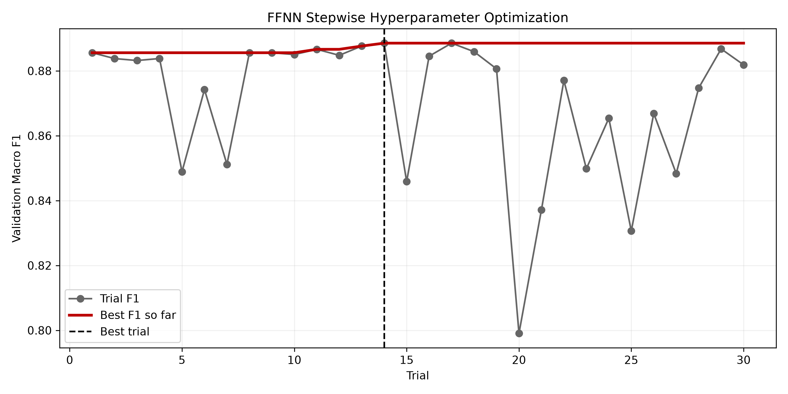
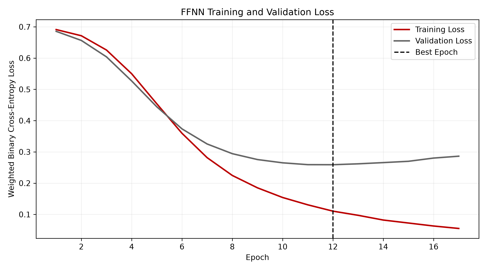

# Milestone 3: Refined Solution & App Prototype

**CSE 3521: Survey of AI · Autumn 2026 · Group Gamma**  
**The Ohio State University · Data seed: 44 · Submission: November 22, 2026**  
**GitHub repository:** https://github.com/PowerSixxx/cse3521-sentiment  
**Streamlit deployment:** https://cse3521-sentiment.streamlit.app

## 1. Model Comparison

### Dataset and experimental setup

We use a seed-44 sample of 50,000 Amazon Fine Food Reviews. Reviews rated **1–2 stars** are labeled negative, and reviews rated **4–5 stars** are labeled positive; 3-star reviews are excluded.

Since milestone 2, we've implemented additional data preprocessing to improve the accuracy of our models. First, we noticed that since the reviews a user originated, that many of the words can be misspelled or formatted incorrectly (e.g. missing apostrophe). We implemented a script that standardizes the formatting of words, especially for contraction words such as "can't", "shouldn't", and "won't" which we hypothesize would contribute to a positive or negative sentiment rating. Also, we compared words to a standard dictionary and corrected any misspelled words that fall within an acceptable limit. Words that are misspelled but multiple possible corrections or a correction could not be found reliably were kept original.  We use a stratified 80/20 train/test split (seed 44), yielding 34,278 training and 8,570 test reviews. The same held-out test set is used for the baseline comparison.

### Unified model comparison

**Table 1. Model performance on the held-out test set**

| Model | Accuracy | Macro precision | Macro recall | Macro F1 | Training Time (m approx) | 
|---|---:|---:|---:|---:|---:|
| Majority class | 0.8400 | 0.4200 | 0.5000 | 0.4565 | N/A |
| Multinomial NB (BoW) | 0.9177 | 0.8397 | 0.8695 | 0.8535 | 1 |
| Logistic Regression (TF-IDF) | 0.9286 | 0.8600 | 0.8900 | 0.8718 | 1 |
| Feedforward Neural Network (FFNN) /w Hyperparameter Search | **0.9313** | **0.8643** | **0.8906** |**0.8776**| **120** |

### Best-performing model

**Interpretation:** 

The best performing model utilizing the macro F1 score would be the Feedforward Neural Network with hyperparameter search. This approach utilizes a TF-IDF vector with weights and a FFNN model to learn non-linear relationships between corresponding weights assigned to words. More precisely, it does not only account for the individual weight of a word for contributing to sentiment rating, but it accounts for instances where two different words with different associated sentiment would result in an alternate outcome. For example, "not" and "reliable" where the word "reliable" could push the sentiment towards positive. When combing both words together, the FFNN model would push the sentiment much more significantly to negative. 

The FFNN model is the most effective; however, it comes at a significant price of compute cost as tuning for proper hyperparameters is expensive. A simple classification model can be handled nearly as effectively utilizing a logistic regression model on a TF-IDF vector in a practical environment. A FFNN model approach would be more practical when the dataset is substantially larger and more relationships exist within the data that the FFNN model could capture. From the perspective of compute cost, the FFNN model could be retrained quickly with additional data once the hyperparameters are set. This training time is more of an initial cost than a recurring cost. 

## 2. Deep / Modern Model Analysis

### Model architecture

Our planned deep model is a **Feedforward Neural Network (FFNN) /w Hyperparameter Search** for binary sentiment classification.

| Component | Configuration |
|---|---|
| Input representation and dimension | TF-IDF feature vectors; dimension determined by the fitted vocabulary size |
| Hidden layers and units | 2 fully connected hidden layers with 64 and 32 neurons, respectively |
| Activation functions | 	ReLU for both hidden layers; sigmoid for output probability during inference |
| Output layer | Single neuron producing a binary classification logit; classification threshold of 0.50 |
| Loss function | Class-weighted binary cross-entropy with logits (BCEWithLogitsLoss), using balanced class weights |
| Optimizer and learning rate | AdamW optimizer with a learning rate of 0.0001 |
| Batch size and epochs | Batch size of 256; maximum of 50 epochs |
| Regularization / early stopping | Dropout of 30% and 20% for the respective hidden layers; weight decay of 0.074989421; early stopping with a patience of 5 epochs based on validation loss |

### Training and validation results

**Figure 0. Hyperparameter Search.**

{width=80%}

First, the the FFNN model is tested against 30 different hyperparameter settings. The search starts at a random but within a reasonable range. Hyperparameters such as weight decay, learning rate, input dropout/hidden layer dropout, batch size, and hidden layer dimensions is tweaked. The hyperparameter settings are dictated the best for the settings that result in the highest macro F1 score. The macro F1 score is utilized as the balance between positive and negative sentiment is not equal. The testing first begins by shifting settings that lead to a higher F1 score, once that score is maximized, the test begins to shift hyperparameters significantly to break out of possible local maximums.  

**Figure 1. Training and validation loss across epochs.**

{width=80%}

This figure is based on the selected hyperparameter settings from the previous figure. This loss curve helps understand how the model would predict with unseen data utilizing a validation data set (10% chunk from the 80% data split, remaining 20% is the test data). The best epoch or weights is determined by using the highest macro F1 score from the validation data specifically. In this case, the best epoch would be iteration 12.

### Advantages and limitations

**Advantage:** 

The most substantial improvement to a FFNN approach over classical models for our application would be the ability for FFNN models to learn patterns in non-linear relationships. This is most significant when meaning from reviews is derived by words in context, rather than words on their own. However, the practical benefit of this feature depends on the data. If the majority of the reviews have positive sentiment, and utilize language that is not bound to context. Then the practical benefit of the model would be low as the relationship is generally linear. However, in our application, there were a few cases of language bound to context. An improvement to false predictions is visible by the corresponding confusion matrix relative to other model matrices. 

**Limitation:** 

The largest drawback to this approach would be the initial compute cost of hyperparameter tuning. The model is heavily reliant on tuned hyperparameters. For example, the FFNN approach can easily result in overfitting due to the ability for FFNN to adapt to non-linear patterns. It is crucial to add dropout between each hidden layer to generalize the model. Tweaking these parameters can be costly as dropout is one of many parameters, and the total combinations that exist is large. 

## 3. Streamlit App Description

### Application overview

Our Streamlit app is a working prototype of the sentiment system. A user pastes or types any food review and immediately sees a positive/negative prediction from each of our trained models, side by side, with a confidence score and the words that drove each decision. It is aimed at a non-technical reader, such as a seller or a product team checking how customers feel, so the app explains its results in plain language. The app serves all three trained models: **Multinomial Naive Bayes (Bag of Words)**, **Logistic Regression (TF-IDF)**, and the **Feedforward Neural Network (TF-IDF, PyTorch)**. The classical models are saved as scikit-learn pipelines (vectorizer + classifier) in `models/`. The FFNN is saved as a bundle of its fitted TF-IDF vectorizer and network weights, which `scripts/ffnn_model.py` rebuilds into the same interface. Either way, the app reuses exactly the vocabulary and weights learned during training, and adding a model takes one line in the `MODELS` dictionary in `app.py`.

**Table 2. Pages (tabs) of the Streamlit app**

| Tab / page | Purpose | User interaction and output |
|---|---|---|
| Live prediction | Live sentiment prediction from every loaded model | The user types or pastes a review, or clicks one of four example buttons (Positive, Negative, Mixed, Negation). Each model shows its label, its confidence, and a P(positive) bar. For the two linear models, a "Why?" panel lists the five words or phrases pushing most toward positive and toward negative (Naive Bayes: count × log-probability ratio; Logistic Regression: TF-IDF weight × coefficient). The FFNN has no per-word weights, so it shows only its prediction. A warning appears when the models disagree. A final panel shows the cleaned text the models actually received. |
| Model performance | Results on the shared held-out test set | A table of accuracy, macro precision, macro recall, macro F1 and training time for the majority-class baseline and all three models, with the best macro F1 highlighted, plus a confusion matrix for each model. Values are read from `models/model_metrics.json`, which `scripts/export_metrics.py` regenerates after a model is retrained. |
| About the data | Context for non-technical users | Describes the dataset, the label scheme (1–2 stars negative, 4–5 positive, 3 excluded), why macro F1 is used under class imbalance, how each model turns text into numbers, and known weak spots. Shows the star-rating distribution chart. |

The sidebar lists which model files loaded successfully and which input cleaning is active. New reviews are cleaned with the same functions as the training data: the app imports them from `scripts/clean_reviews_script_final.py` (HTML/whitespace cleaning, quote normalization, conservative spelling correction, contraction standardization, negation commas). If that script or `pyspellchecker` is unavailable, the app falls back to basic HTML/whitespace cleaning. A review can also be passed in the URL (`?review=...`), which is useful for sharing a demo link.

### Application screenshots

**Figure 2. Streamlit application — Live prediction tab.**

{width=85%}

After the user clicked the **Mixed** example ("The flavor is great, but the package arrived crushed…"), all three models predict negative, but with very different confidence: Naive Bayes is 98.2% sure, the FFNN 81.7%, and Logistic Regression only 63.9%. The "Why?" panels show the reason for the linear models. Both credit "great" and "is great" toward positive, but "crushed", "broken" and the bigram "great but" pull toward negative. This mixed-review pattern is one of the error types we identified in M2.

**Figure 3. Streamlit application — Model performance tab.**

{width=85%}

The performance tab shows the unified comparison on the 8,570-review test set. The FFNN has the best macro F1 (0.8766), slightly ahead of Logistic Regression (0.8718) and Naive Bayes (0.8535), and it also misses the fewest negative reviews (232 false positives, vs. 244 for Logistic Regression and 276 for Naive Bayes).

### Running the application

From the repository root, run:

```bash
pip install -r requirements.txt
streamlit run app.py
```

The app opens at `http://localhost:8501`. The model files are committed to `models/`, so the app runs without retraining or downloading the dataset.

**Deployment status:** Deployed to Streamlit Community Cloud from this repository (`main` branch, entry point `app.py`, Python 3.12, dependencies from `requirements.txt`). Every push to `main` redeploys the app automatically.

**Deployment URL:** https://cse3521-sentiment.streamlit.app

## 4. Reproducibility Note

The reproducibility instructions are documented in `README.md` in the GitHub repository.

**Dataset:** Amazon Fine Food Reviews — https://www.kaggle.com/datasets/snap/amazon-fine-food-reviews

**Repository:** https://github.com/PowerSixxx/cse3521-sentiment

### Environment setup

```bash
git clone https://github.com/PowerSixxx/cse3521-sentiment.git
cd cse3521-sentiment
pip install -r requirements.txt
```

[Confirm the dependency file exists and specify the supported Python version.]

### Reproducing the model results

| Step | Instructions / repository file |
|---:|---|
| 1 | Download Reviews.csv and place it in [actual data directory]. |
| 2 | Generate the seed-44 sample and run finalized preprocessing using [script or notebook]. |
| 3 | Reproduce the train/validation/test splits using [script and seeds]. |
| 4 | Train the classical models using [notebook or command]. |
| 5 | Train the FFNN using [notebook or command]. |
| 6 | Generate evaluation metrics and loss curves using [script or notebook]. |
| 7 | Save model artifacts to [directory] and run the Streamlit application. |

[Replace all placeholders with exact paths and executable commands. Ensure README.md contains the same instructions, including how to obtain saved models or retrain them.]

## 5. Individual Progress Log

**Baowen Liu — App Engineer.** Since M2, I extended the Streamlit app from a single Naive Bayes prediction page into a three-tab prototype. The Live prediction tab now shows Naive Bayes, Logistic Regression and the FFNN side by side, explains each prediction with the words that pushed it toward positive or negative (also for Logistic Regression, using TF-IDF weight × coefficient), and warns when the models disagree. The Model performance tab shows the comparison table and the confusion matrices, and the About tab describes the dataset. I connected the app to the team's cleaning script so new reviews are preprocessed the same way as the training data. I also wrote `scripts/export_metrics.py`, which scores every saved model on the shared test set and writes the metrics file the app reads, and `scripts/ffnn_model.py`, which loads Andrew's PyTorch FFNN so the app and the metrics script can use it like the scikit-learn models. I deployed the app to Streamlit Community Cloud (https://cse3521-sentiment.streamlit.app), wrote the app documentation in Section 3, and took the screenshots. Before M4, I will rerun the metrics script on the retrained models and prepare the live demo segment of the presentation.

**Henry Benner — ML Engineer (classical).** Henry implemented the Log-reg TF-IDF model and provided the corresponding scores / charts.

**Tarun Shivakumar — Data Engineer and Analyst / Writer.**  Since M2, Tarun wrote the reproducibility section of the README. It gives the steps in order for downloading the data, sampling and cleaning it with seed 44, running the notebooks and serving the app, along with the expected row counts so another team can check their data matches ours. For evaluation, he made every model read one shared cleaned dataset and train/test split, so all results are scored on the same 20% test set. He also added a validation slice of the training set for the neural network's loss curves and for the tokenizer comparison, so that design choices are made without looking at the test set. He moved all text cleaning into a shared module used by both the notebooks and the Streamlit app, so new reviews are cleaned exactly like the training data. For the report, he worked with Andrew on the model comparison table and assembled the M3 write-up. Before M4, he will merge the pipeline changes into the main branch, retrain and commit the classical models on the cleaned data, report the final tokenizer comparison, and fix a minor bug where contraction fixes are applied inside URLs. He will then write the final report, coordinate everyone's contribution paragraphs, and proofread the submission.

**Andrew Kobasko — Project Lead and ML Engineer (deep).** Since M2, I created the M3 template and provided general steps that need to be accomplished to the group. I also implemented TF-IDF + FFNN model with hyperparameter tuning. I let the tuning application run on my workbench computer locally overnight for optimization. I then provided the optimized hyperparameters and model weights as a joblib file for Streamlit app. I also completed sections 1 and 2 or model comparison and deep / model of the M3 checkpoint log. 
