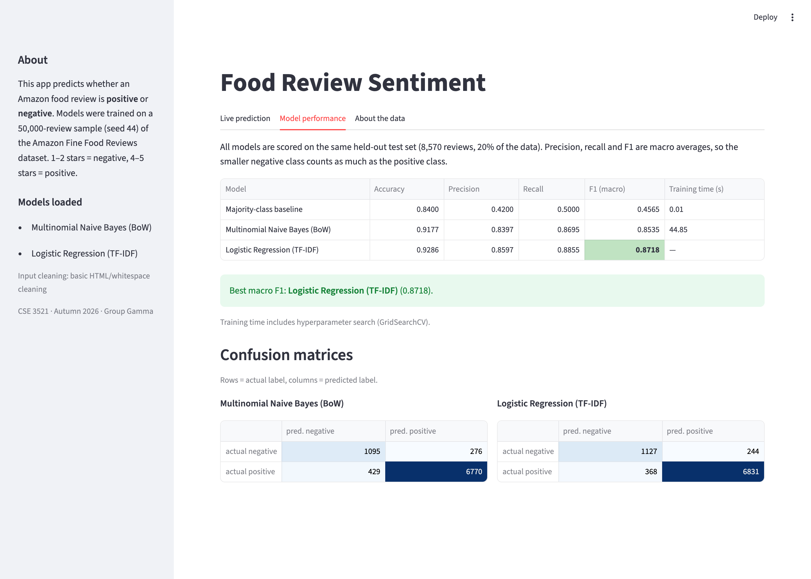

# Milestone 3: Refined Solution & App Prototype

**CSE 3521: Survey of AI · Autumn 2026 · Group Gamma**  
**The Ohio State University · Data seed: 44 · Submission: November 22, 2026**  
**GitHub repository:** https://github.com/PowerSixxx/cse3521-sentiment  
**Streamlit deployment:** [Insert URL or indicate local prototype]

## 1. Model Comparison

### Dataset and experimental setup

We use a seed-44 sample of 50,000 Amazon Fine Food Reviews. Reviews rated **1–2 stars** are labeled negative, and reviews rated **4–5 stars** are labeled positive; 3-star reviews are excluded.

[Describe the finalized preprocessing changes since M2, including contraction handling, spelling correction, and deduplication, as applicable. Report the final dataset size, training/validation/test sizes, and confirm that all models are evaluated on the same held-out test set.]

### Unified model comparison

**Table 1. Model performance on the held-out test set**

| Model | Accuracy | Macro precision | Macro recall | Macro F1 | Training time (s) |
|---|---:|---:|---:|---:|---:|
| Majority class | — | — | — | — | — |
| Multinomial NB (BoW) | — | — | — | — | — |
| Logistic Regression (TF-IDF) | — | — | — | — | — |
| Feedforward Neural Network (FFNN) | — | — | — | — | — |

[Include one row per additional trained model. Bold the best results. Specify the hardware and whether training times include feature extraction or hyperparameter tuning. Use consistent macro-averaged metrics across models.]

### Best-performing model

**Interpretation:** [Identify the best-performing model using macro F1 as the primary comparison metric, or justify another metric. Quantify its improvement over the classical and majority-class baselines. Explain the differences using course concepts such as model capacity, nonlinear decision boundaries, feature representation, and sequence information where applicable. Discuss any trade-off between predictive performance and training time.]

## 2. Deep / Modern Model Analysis

### Model architecture

Our planned deep model is a **Feedforward Neural Network (FFNN)** for binary sentiment classification.

[Confirm the implemented architecture and explain why it was selected. Describe the input representation, hidden layers, activation functions, output layer, and regularization. If another modern model was used, replace the FFNN description accordingly.]

| Component | Configuration |
|---|---|
| Input representation and dimension | [Insert] |
| Hidden layers and units | [Insert] |
| Activation functions | [Insert] |
| Output layer | [Insert] |
| Loss function | [Insert] |
| Optimizer and learning rate | [Insert] |
| Batch size and epochs | [Insert] |
| Regularization / early stopping | [Insert] |

### Training and validation results

**Figure 1. Training and validation loss across epochs.**

{width=80%}

**Interpretation:** [Describe how training and validation loss change over time, identify the best epoch, and discuss convergence, overfitting, or underfitting. Explain how the final model checkpoint was selected without using the held-out test set.]

### Advantages and limitations

**Advantage:** [Explain one demonstrated or architectural advantage over the classical baselines, such as learning nonlinear interactions between input features.]

**Limitation:** [Explain one limitation, such as training cost, interpretability, or data requirements. If the FFNN uses TF-IDF, clarify that it does not directly model word order beyond information retained in its input features.]

## 3. Streamlit App Description

### Application overview

[Describe the working sentiment classification prototype, its intended users, available trained models, and the outputs presented to users.]

| Tab / page | Purpose | User interaction and output |
|---|---|---|
| [Actual page name] | [Describe functionality] | [Describe inputs and displayed results] |
| [Actual page name] | [Describe functionality] | [Describe inputs and displayed results] |

[Replace the example rows with the actual tabs or pages of the running application.]

### Application screenshots

**Figure 2. Streamlit application — main interface.**

{width=85%}

[Describe the controls available to the user and how a review is submitted.]

**Figure 3. Streamlit application — prediction results or second page.**

{width=85%}

[Explain the displayed prediction, model selection, or other functionality shown in the screenshot.]

### Running the application

From the repository root, run:

```bash
streamlit run app.py
```

**Deployment status:** [Running locally / staging deployment / deployed to Streamlit Community Cloud]

**Deployment URL:** [Insert live URL if available]

## 4. Reproducibility Note

The reproducibility instructions are documented in `README.md` in the GitHub repository.

**Dataset:** Amazon Fine Food Reviews — https://www.kaggle.com/datasets/snap/amazon-fine-food-reviews

**Repository:** https://github.com/PowerSixxx/cse3521-sentiment

### Environment setup

```bash
git clone https://github.com/PowerSixxx/cse3521-sentiment.git
cd cse3521-sentiment
pip install -r requirements.txt
```

[Confirm the dependency file exists and specify the supported Python version.]

### Reproducing the model results

| Step | Instructions / repository file |
|---:|---|
| 1 | Download Reviews.csv and place it in [actual data directory]. |
| 2 | Generate the seed-44 sample and run finalized preprocessing using [script or notebook]. |
| 3 | Reproduce the train/validation/test splits using [script and seeds]. |
| 4 | Train the classical models using [notebook or command]. |
| 5 | Train the FFNN using [notebook or command]. |
| 6 | Generate evaluation metrics and loss curves using [script or notebook]. |
| 7 | Save model artifacts to [directory] and run the Streamlit application. |

[Replace all placeholders with exact paths and executable commands. Ensure README.md contains the same instructions, including how to obtain saved models or retrain them.]

## 5. Individual Progress Log

**Baowen Liu — App Engineer.** [Describe contributions since M2, including actual app functionality, model integration, and deployment progress. Identify remaining tasks before M4.]

**Henry Benner — ML Engineer (classical).** [Describe contributions since M2, including Logistic Regression, classical model training, evaluation, and comparison. Identify remaining tasks before M4.]

**Tarun Shivakumar — Data Engineer and Analyst / Writer.** [Describe contributions since M2, including reproducibility documentation, evaluation, and report preparation. Identify remaining tasks before M4.]

**Andrew Kobasko — Project Lead and ML Engineer (deep).** [Describe contributions since M2, including finalized preprocessing, FFNN architecture and training, loss curves, model comparison, and report coordination. Identify remaining tasks before M4.]
