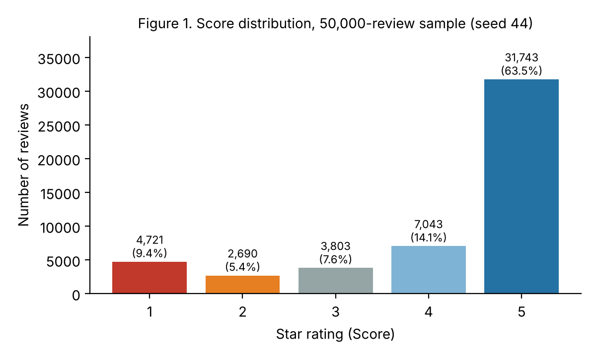

# Milestone 1: Project Charter & Scope

**GitHub repository:** https://github.com/PowerSixxx/cse3521-sentiment

CSE 3521, Autumn 2026 · Group Gamma · Data seed: **44** · Submitted Tue Nov 10, 2026

<!-- Fill every [BRACKET]. Delete this comment before exporting. -->

## 1. Team Roster

| Name | OSU email | Primary role | What I will own |
|----|-----|-----|------------------|
| [Name 1] | [name.#]@osu.edu | Project Lead | I will run weekly check-ins, own the milestone timeline, and integrate everyone's work into each submission. |
| [Name 2] | [name.#]@osu.edu | Data Engineer | I will own data cleaning, the shared train/test split, and the BoW and TF-IDF pipeline. |
| [Henry Benner] | [benner.162]@osu.edu | ML Engineer (classical) | I will train and tune Naive Bayes and Logistic Regression and maintain the model comparison table. |
| [Name 4] | [name.#]@osu.edu | ML Engineer (deep) | I will build and train our neural network model and compare it to the classical baselines. |
| [Name 5] | [name.#]@osu.edu | App Engineer | I will build and deploy the Streamlit app with live predictions from at least two models. |
| [Name 6] | [name.#]@osu.edu | Analyst / Writer | I will lead error analysis, write the reports, and prepare the presentation deck. |

Every member also contributes code or analysis outside their primary role and commits from their own GitHub account. [For a team of 4 or 5, merge roles, e.g. Data Engineer + classical ML Engineer.]

## 2. Problem Statement

Online food retailers receive far more reviews than any team can read. Star ratings summarize opinion, but many channels where customers write free text (support tickets, social posts, survey comments) carry no rating, and the text explains *why* a customer is unhappy. Our system answers one question: **given only the text of a food review, is the customer's sentiment positive or negative?**

The users are product managers, category buyers and customer-support leads at an online grocery or marketplace. The prediction supports three decisions: which products to investigate when negative sentiment rises, which unrated feedback support should handle first, and which products to promote. Negative reviews are the minority but the most actionable class, so we will judge models mainly on negative-class recall and F1, not accuracy alone. Our Streamlit app lets a non-technical user paste any review and compare several models' predictions side by side.

## 3. Dataset Summary

We use a 50,000-review sample of Amazon Fine Food Reviews (568,454 reviews, Kaggle), drawn with `df.sample(n=50000, random_state=44)`. The input is the review `Text` (optionally `Summary`); the target is derived from `Score`. **Label scheme:** 1–2★ = negative, 4–5★ = positive; 3★ reviews are excluded from the main task because their wording is mixed. A three-class version is a stretch goal.

| Statistic | Value |
|------|----------|
| Rows | 50,000 (10 columns) |
| Score 1 / 2 / 3 / 4 / 5 | 4,721 / 2,690 / 3,803 / 7,043 / 31,743 |
| Positive / Neutral / Negative | 38,786 (77.6%) / 3,803 (7.6%) / 7,411 (14.8%) |
| Average review length | 80.5 words (median 56); summary 4.1 words |
| Missing values | `Summary` 2, `ProfileName` 2; none in `Text` or `Score` |
| Duplicate review texts | 3,611 rows (7.2%) |
| Binary set after dedup, 3★ dropped | 42,856 rows, 84.0% positive |

{width=55%}

*Figure 1. Score distribution of our sample (seed 44). 5-star reviews alone are 63.5% of the data.*

**Data quality issues observed:**

- **Class imbalance:** 84.0% of the binary set is positive, so always predicting "positive" already scores about 84.0% accuracy. We will report this majority baseline, use a stratified split, report per-class metrics and macro-F1, and try class weighting.
- **Duplicates:** 3,611 rows (7.2%) repeat another row's text, mostly one review posted under several product variants. We will deduplicate on `Text` *before* splitting so the same review cannot appear in both train and test sets.
- **HTML noise:** about 25.3% of reviews contain tags such as ` `, which we will strip.
- **Missing values** are rare and only in non-essential columns; empty summaries become empty strings.

## 4. Technical Approach

All models use the same cleaned, deduplicated, stratified 80/20 split with a fixed random state. Hyperparameters are tuned by cross-validation on the training set only. Each model is reported with accuracy, precision, recall, F1 and a confusion matrix, against the majority-class baseline.

| Component | Choice and reason | Course link |
|---|-----------------|---|
| Features 1 | **Bag of Words** (unigrams + bigrams): simple, interpretable, the natural input for Multinomial NB; bigrams capture "not good". | Lesson [X] |
| Features 2 | **TF-IDF** (unigrams + bigrams): down-weights words common to all reviews so sentiment words stand out; usually stronger for linear models. | Lesson [X] |
| Classical 1 | **Multinomial Naive Bayes**, tuning smoothing α: fast probabilistic baseline for word counts. | Lesson 9 [confirm] |
| Classical 2 | **Logistic Regression**, tuning C, L1/L2 and class weights: strong linear model whose coefficients show which words drive each class. | Lesson [X] |
| Deep | **Feedforward neural network** on TF-IDF (1–2 hidden layers, dropout): tests whether a non-linear model beats linear baselines on the same features. | Lesson [X] |
| Stretch | **DistilBERT** fine-tuned on a subset: reads word order and context, so it should handle negation and mixed reviews better. | Lesson [X] |
| App | **Streamlit** app loads saved models from `models/` and shows label and confidence from 2+ models side by side; deployed on Streamlit Community Cloud. | n/a |

## 5. Project Timeline

| Week | Milestone | Who does what |
|---|---|------------------|
| Nov 9–10 | **M1** (Tue Nov 10) | [Data Eng] sample, stats, Figure 1. [Lead] repo, README, charter draft. [Writer] edit and export PDF. All: confirm roles and label scheme. |
| Nov 11–15 | **M2** (Sun Nov 15) | [Data Eng] cleaning, dedup, split, BoW and TF-IDF. [ML classical] Naive Bayes + majority baseline. [ML deep] FFNN code. [App Eng] Streamlit skeleton. [Writer] error analysis, M2 report. |
| Nov 16–22 | **M3** (Sun Nov 22) | [ML classical] tune LR and NB. [ML deep] train FFNN (DistilBERT if time), loss curves. [App Eng] connect models, staging deploy. [Data Eng] reproducibility in README. [Lead + Writer] comparison table, M3 report. |
| Nov 23–29 | **M4** (Sun Nov 29) | [App Eng] final deployment. [Writer] final report. [Lead] slides. All: contribution paragraphs, proofreading. |
| Nov 30–Dec 2 | Live demo | All: rehearse the 8-minute demo (everyone speaks) and Q&A on their own part. |

We meet [DAY/TIME] weekly on [in person / Zoom / Discord], track tasks in GitHub Issues, and set an internal deadline two days before each milestone.

**Risks and mitigation:**

- *DistilBERT is too slow on our laptops.* The FFNN is our required deep model; DistilBERT is a stretch goal trained on a 5,000–10,000 review subset on Google Colab's free GPU.
- *Imbalance hides poor negative-class performance.* We report the majority baseline, per-class metrics and macro-F1, and try `class_weight="balanced"`.
- *Model files too large for GitHub or Streamlit Cloud.* The app serves the small scikit-learn models (a few MB with `joblib`); a large deep model would be hosted on the Hugging Face Hub.

## 6. GitHub Repository

**Public repository:** https://github.com/PowerSixxx/cse3521-sentiment. It follows the required layout: `README.md` (title, team, description, setup, live app URL placeholder), `data/` (download and sampling instructions; CSVs are git-ignored), `notebooks/`, `models/`, `report/`, and `requirements.txt` with pinned versions. `app.py` is added at M3. Every member has write access and commits from their own account.
