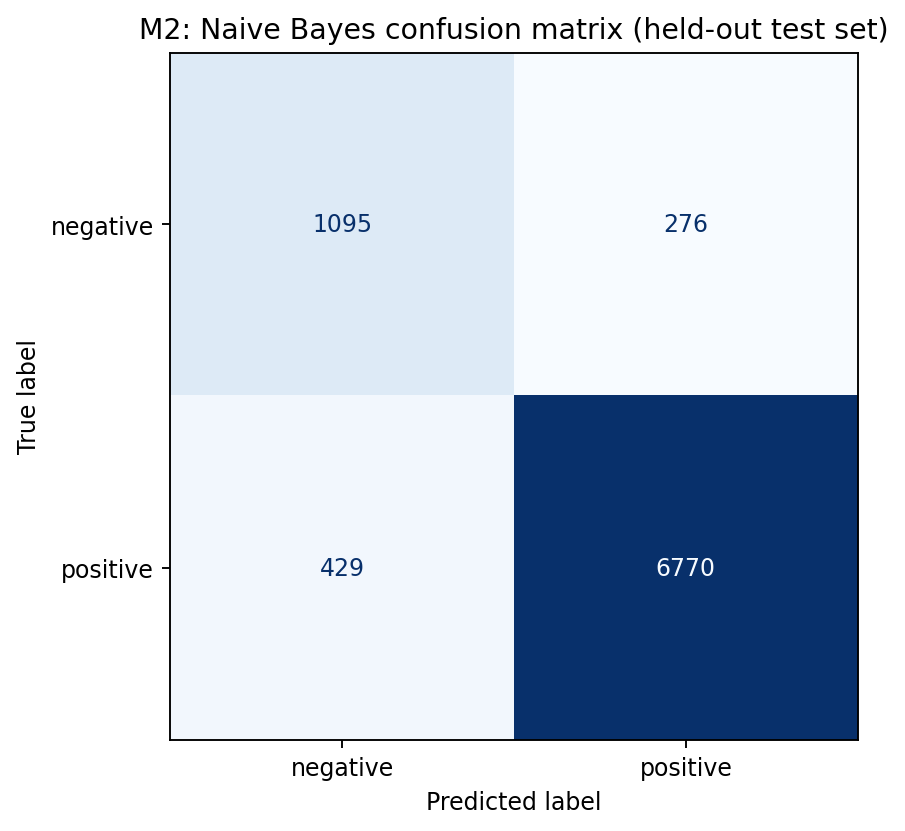

# Milestone 2: Classical ML Results (Group Gamma)

Dataset: Group Gamma 50,000-review sample, random seed 44.

Usable binary reviews after filtering and deduplication: 42848. Training set: 34278. Test set: 8570.

Labels: 1-2 stars = negative, 4-5 stars = positive. 3-star reviews excluded.

Split: 80/20 stratified, split seed 44.

Features: Bag of Words unigrams and bigrams, up to 50,000 vocabulary terms.

Best Naive Bayes alpha: 0.5. Cross-validation macro F1: 0.8580.

## Test metrics

| Model | Accuracy | Precision (macro) | Recall (macro) | F1 (macro) | Negative recall | Negative F1 | Training seconds |
| --- | --- | --- | --- | --- | --- | --- | --- |
| Majority-class baseline | 0.8400 | 0.4200 | 0.5000 | 0.4565 | 0.0000 | 0.0000 | 0.02 |
| Multinomial Naive Bayes (BoW) | 0.9177 | 0.8397 | 0.8695 | 0.8535 | 0.7987 | 0.7565 | 64.71 |

## Confusion matrix

## Informative terms

**Positive:** very fresh, can beat, also great, best ve, best coffee, not overpowering, flavorful and, snack or, yum yum, great too

**Negative:** false advertising, what disappointment, never purchase, zero stars, threw away, cannot return, and unpleasant, huge disappointment, two stars, emerald forest

## Error analysis 

## 1. Error Analysis

We went over ten reviews that our Multinomial Naive Bayes model classified incorrectly. Some of these reviews contained positive and negative language, which made the sentiment difficult to identify. In one example, a review might praise the taste of a product and then also complain about its packaging. This might cause the model to focus on positive words even when the review itself was negative.

A different possibility is negation. Phrases such as "not very good" have positive words, such as "good," but still have a negative sentiment. Since Naive Bayes primarily relies on the frequencies of words, it can struggle with the context of these phrases.

To improve this performance, we can experiment with TF-IDF features. We can also tune smoothing parameters and use Logistic Regression to better identify sentiment patterns.

## Interpretation 

Our Multinomial Naive Bayes model had an accuracy of 91.77% compared with 84.00% for the majority-class baseline. This shows that our Naive Bayes model performed better overall, improving accuracy by 7.77 percentage points.

The majority-class baseline always predicts positive sentiment, so it fails to identify negative reviews. Its negative-class recall and F1-score are both zero.

Naive Bayes achieved a negative-class recall of 79.87% and a negative-class F1-score of 0.7565. This indicates that the model can identify a majority of negative reviews rather than always predicting the positive class.

These results show that Naive Bayes can learn relationships between word frequencies and sentiment. However, the model still makes mistakes when identifying negative reviews, meaning there is room for improvement.
